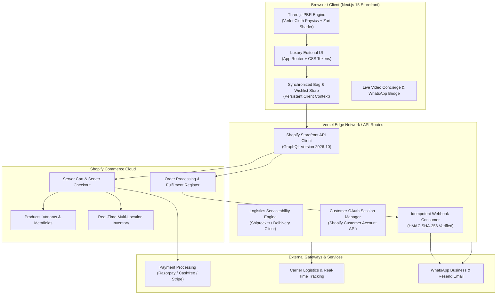

# NOOLAM · Master Implementation Plan (Phases 1–20)
**Document Version:** 1.0.0  
**Target Architecture:** Next.js 15 + Shopify Headless (Storefront GraphQL API) + Three.js PBR Cloth Engine  
**Deployment Target:** Vercel Pro (Edge Network) + GitHub Continuous Integration  

---

## 1. Architectural Blueprint & Data Flow

---

## 2. Phase-by-Phase Execution Roadmap

### Phase 1: Brand Identity & Creative Production
- **Objective:** Finalize NOOLAM's luxury sensory identity and implement the asset ingestion pipeline.
- **Deliverables:**
  - Create `docs/ASSET_MANIFEST.md` cataloging all 68 visual assets with dimensions, aspect ratios, generation prompts, and storage paths.
  - Implement image ingestion fallback logic ensuring zero layout shifts.
  - Enforce Product Authenticity Rules: AI visuals reserved strictly for conceptual campaigns; authentic product photography reserved for SKU listings and purchasing cards.

### Phase 2: Shopify Commerce Foundation
- **Objective:** Connect Next.js 15 to Shopify Storefront GraphQL API (`2026-10`).
- **Deliverables:**
  - Build strongly-typed Shopify GraphQL client (`lib/shopify/client.ts`).
  - Implement queries for Products, Collections, Product Variants, and Inventory.
  - Implement Shopify Server Cart mutations: `cartCreate`, `cartLinesAdd`, `cartLinesUpdate`, `cartLinesRemove`, `cartDiscountCodesUpdate`.
  - Secure API tokens: Storefront Access Token for public reads; Admin API Token isolated strictly to server-side routes.

### Phase 3: Complete Product Catalogue & Metafields
- **Objective:** Model genuine Kanchipuram silk product attributes in Shopify.
- **Deliverables:**
  - Create product schemas with custom metafields:
    - `custom.zari_type` (*Pure 3-Ply Gold Zari* vs *Tested Half-Fine Zari*)
    - `custom.weave_technique` (*Korvai*, *Petni*, *Brocade*, *Butta*)
    - `custom.weight_grams` (e.g. *780g heavy silk*)
    - `custom.silk_mark_number` (*Official certification code*)
    - `custom.blouse_piece_included` (*Included 80cm unstitched*)
  - Implement stock availability badges, low-stock warnings, and sold-out states.

### Phase 4: INR-First International Commerce
- **Objective:** Pristine Indian Rupee pricing formatting with verified international conversion.
- **Deliverables:**
  - Centralized currency formatter (`lib/currency.ts`) supporting Indian numbering system (`₹1,25,000`).
  - Multi-currency presentation (INR, USD, GBP, AED) calculated from verified exchange rates.
  - Integration with Shopify Markets for localized catalog presentation.

### Phase 5: Payment Gateway Integration
- **Objective:** Enterprise-grade payment handoff and verification.
- **Deliverables:**
  - Compatibility analysis for India-based Shopify merchants (Razorpay, Cashfree, Shopify Payments).
  - Secure redirect to Shopify Hosted Checkout containing payment gateway bindings.
  - Server-side webhook listener (`app/api/webhooks/shopify/route.ts`) validating raw body HMAC SHA-256 signatures before processing order events.

### Phase 6: Shipping & Logistics Integration
- **Objective:** Real-time Indian PIN code serviceability and carrier automation.
- **Deliverables:**
  - PIN code validation engine (`lib/shipping/pincode.ts`) verifying delivery timelines and COD eligibility across 19,000+ Indian pincodes.
  - Shiprocket / Delhivery API client for live rate quoting and automated AWB generation.
  - International shipping workflow documentation for customs declarations, duty responsibilities, and DHL Express courier routing.

### Phase 7: Luxury Customer Experience & Navigation
- **Objective:** Elevate every interaction into a bespoke digital flagship experience.
- **Deliverables:**
  - Synchronized slide-over Shopping Bag with live promo discounts and free shipping meter.
  - Saved Heirlooms Wishlist drawer with one-click "Move to Bag".
  - Dedicated Collection filtering (Heritage Kanjivaram, Bridal Muhurtham, Festive Brocade).
  - Full Product Detail modal displaying deep fabric specifications, zoomable gallery, and silk care.

### Phase 8: Advanced Three.js Silk Experience
- **Objective:** Maximize WebGL realism while maintaining 60 FPS on mobile and desktop.
- **Deliverables:**
  - Verlet cloth physics solver with optimized damping, stiffness, and vertex pinning.
  - Metallic PBR shader simulating gold and silver zari specular glint under dynamic lighting.
  - Automatic mobile detection reducing particle grid density to preserve battery and frame rate.

### Phase 9: Customer Conversion & Concierge Features
- **Objective:** Accelerate high-ticket bridal and festive conversions.
- **Deliverables:**
  - **Silk Finder Discovery Quiz**: Interactive 4-step wizard matching occasions, palettes, and budgets to real sarees.
  - **Blouse Customization Form**: Sleeve length, neckline selector, and custom measurement notes attached as line-item properties.
  - **1-on-1 Video Consultation**: Appointment booking system connecting clients directly with master drapers over WhatsApp video.

### Phase 10: Email, WhatsApp & Customer Communication
- **Objective:** Automated, elegant post-purchase communication.
- **Deliverables:**
  - WhatsApp Business API integration blueprint (Interakt / Wati) for order dispatch updates.
  - Transactional email templates (Resend) featuring Silk Mark certificates and PDF invoices.

### Phase 11: Legal, Privacy & Statutory Compliance
- **Objective:** Comprehensive legal compliance for Indian and international retail.
- **Deliverables:**
  - Policy pages: Privacy Policy, Terms of Service, Shipping Policy, Return & Exchange Policy, Product Authenticity Guarantee, Grievance Officer details.
  - GST invoice compliance: Clear display of CGST/SGST/IGST breakdown and statutory business identification.

### Phase 12: SEO, Analytics & Structured Data
- **Objective:** Dominant search engine visibility for luxury silk searches.
- **Deliverables:**
  - JSON-LD Structured Data: `Product`, `AggregateOffer`, `Organization`, `BreadcrumbList`.
  - OpenGraph & Twitter Card dynamic preview tags for WhatsApp and Instagram link sharing.
  - Automated `sitemap.xml` and `robots.txt` generator.

### Phase 13: Cybersecurity, Reliability & HMAC Verification
- **Objective:** Bank-grade security and tamper prevention.
- **Deliverables:**
  - Constant-time HMAC SHA-256 signature verification on all incoming webhooks.
  - Idempotent request handling with delivery ID tracking to prevent duplicate order executions.
  - Zero client-side exposure of secret keys (`.env.local` strictly isolated).

### Phase 14: Performance & Core Web Vitals Optimization
- **Objective:** 95+ Mobile and Desktop Lighthouse scores.
- **Deliverables:**
  - Responsive AVIF/WebP image pipeline via Next.js Image Optimization.
  - Three.js geometry decimation and texture compression.
  - Dynamic imports for WebGL scenes (`next/dynamic` with SSR disabled).
  - Lenis inertial scroll throttling on low-power devices.

### Phase 15: Rigorous Multi-Tier Testing
- **Objective:** Comprehensive functional, security, and visual test coverage.
- **Deliverables:**
  - Functional unit & integration tests (`vitest` / Jest) for cart math, currency conversion, and PIN validation.
  - Security audit tests validating HMAC rejection of tampered payloads.
  - End-to-end visual tests verifying layouts across desktop and mobile viewports.

### Phase 16: Windows Development & Local Automation
- **Objective:** Frictionless one-command local developer experience on Windows PowerShell.
- **Deliverables:**
  - `scripts/setup.ps1` (Automated dependency verification and config setup).
  - `scripts/start.ps1` (Clean local server launcher with port validation).
  - `scripts/check.ps1` (Linting, type-checking, and build validation).
  - `.env.example` (Clear, documented template of all required environment variables).
  - `LOCAL_SETUP.md` (Step-by-step developer onboarding manual).

### Phase 17: Production Deployment & Staging Workflows
- **Objective:** Structured, risk-free release pipeline on Vercel.
- **Deliverables:**
  - Configuration of Local, Preview, and Production environment scopes.
  - Custom domain DNS guide (A records, CNAME, SSL validation).
  - Production readiness checklist preventing accidental live charges during QA.

### Phase 18: GitHub Version Control & Milestone Commits
- **Objective:** Professional Git history reflecting genuine architectural milestones.
- **Deliverables:**
  - Synchronized, clean milestone commits pushed to `kausikhussain/noolam-saree-showcase`.
  - Comprehensive documentation suite: `ARCHITECTURE.md`, `SETUP.md`, `API_INTEGRATIONS.md`, `SECURITY.md`, `DEPLOYMENT.md`, `CHANGELOG.md`.

### Phase 19: Owner Action & Governance Tracking
- **Objective:** Continuous, transparent tracking of business owner responsibilities.
- **Deliverables:**
  - Living `OWNER_ACTIONS.md` ledger specifying prerequisites, security best practices, and launch blockers.

### Phase 20: Final Acceptance & Launch Verification
- **Objective:** Formal verification against the 24 master acceptance criteria before opening the store to public patrons.

